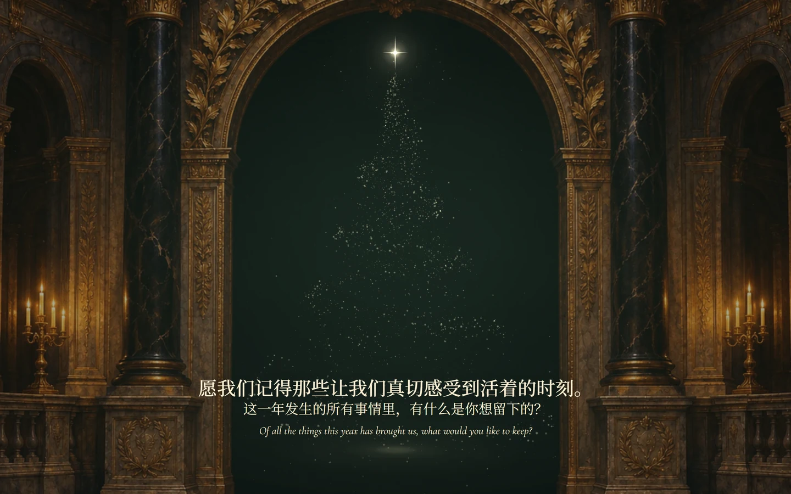
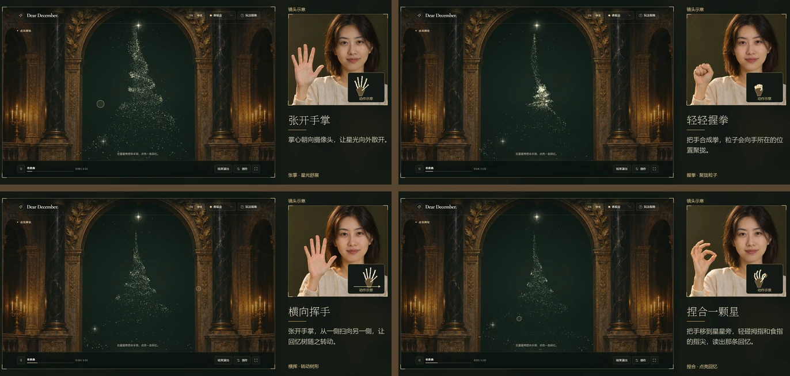
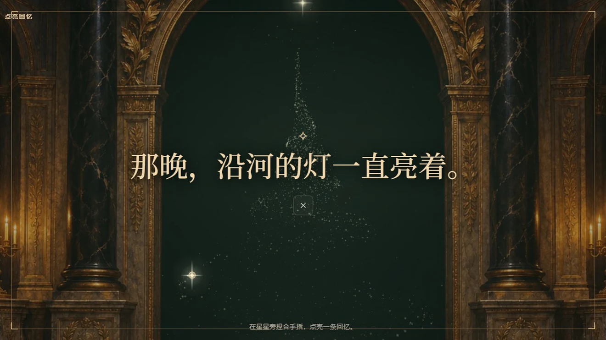

# Dear December

*Some things are worth keeping.*

[Enter the installation](https://dear-december-memories.sweet-pony-8082.chatgpt.site/) · [Download the 49-second gesture film](https://raw.githubusercontent.com/Gloria040510/dear-december/main/media/dear-december-gesture-demo.mp4) · [简体中文](README.zh-CN.md)



At the end of the year, you might think of a train you took while it snowed, or the friend who turned around at the crossing to wait for you. **Dear December** is an interactive winter installation. Write down up to five things you want to remember, and each becomes a star on a Christmas tree. The music changes the way the tree breathes. Your hands move its light. When the tree takes shape, a small pinch brings one of those sentences back into view.

There is room for five memories. Choosing what goes into them is part of the work. Give an ordinary moment a sentence, then give it a few seconds to come into the light.

## Begin with a letter

1. **Write something you want to keep.** Add up to five memories. Choose the original *Winter Nocturne* score or a song from your device. Use **EN / 中文** to switch the interface and export text. The first visit follows your browser language, and the site remembers your selection on the device.
2. **Move the light.** Select **Hand gestures**, press **Begin**, allow camera access, and bring your hands into frame. You can also use a mouse or touchscreen. Drag to gather the light, or hold Shift while moving the mouse to spread it. **Watch demo** plays a full performance and supplies sample memories when the fields are empty.
3. **Open a memory.** Once the tree takes shape, move your hand near a star and bring your thumb and index finger together. With a mouse or touchscreen, select the star directly.
4. **Keep the finished piece.** Save a PNG after the music ends or choose **End performance**. To record the process, open **Creator** during the performance, select a composition and format, and start recording. **Stop recording** downloads the clip with soundtrack audio.

## A guide to the gestures



| What to do | What happens |
| --- | --- |
| Face your palm toward the camera and spread your fingers | The starlight opens outward |
| Close your fingers into a loose fist | Particles gather around your hand |
| Slowly move two open hands apart or together | The tree widens as your hands separate. It contracts and brightens as they come together |
| Sweep one open hand sideways | Stardust rotates in the direction of the swipe |
| Pinch near a star once the tree has formed | The star reveals the memory it holds |

The film and storyboard pair an actual screen recording with a simulated person and simulated gesture input. The website generated the particles, revealed the memory, and exported the poster as it ran.



## How the light moves

**Light and form.** The palace is an illustrated setting for a tree generated in real time with Three.js, WebGL 2, and GLSL. Up to 65,536 particles move between hand-driven forces and a spiral tree structure on the GPU. The rendered density adjusts to frame rate, with a smaller CPU simulation when float textures cannot be rendered. Choose from **Champagne**, **Winter**, and **Forest**.

**Movement and sound.** MediaPipe tracks 21 three-dimensional landmarks per hand. An exponential moving average stabilizes the palms, and the distance between two hands shapes the tree. A temporal CNN classifies 32-frame windows of 17 features in ONNX Runtime Web. Geometry supports immediate interaction and low-confidence fallback. Consecutive-frame confirmation and pinch hysteresis reduce accidental triggers. Web Audio measures the FFT, band energies, RMS, spectral centroid and flux, onsets, and approximate beats. Those smoothed signals shape the tree’s breathing, the warmth of its light, and a soft wave beneath the branches. The original *Winter Nocturne* is synthesized in the browser.

**Making and keeping.** Creator mode offers 9:16 and 16:9 framing, a clean cinematic view, and optional camera compositing and person segmentation. Press Esc or C to restore the controls. Posters have a 2,560 px long edge. Recordings have a 1,280 px long edge at up to 30 fps, with formats depending on the browser. Memories, local music, camera frames, and exports are processed on the device. Inference assets may be fetched from Google Cloud Storage and jsDelivr. The camera requires HTTPS or localhost, and the live scene requires WebGL 2.

## Run locally

Use Node.js 20.19+ or 22.12+.

```sh
npm ci
npm run dev
```

Open the local URL Vite prints. Run `npm run build` to produce `dist/` for HTTPS static hosting, or `npm run preview` to inspect the build locally.

## Gesture model and evaluation

```sh
python -m pip install -r model/requirements.txt
python model/generate.py
python model/train.py
```

The [generator](model/generate.py) creates 6,480 sequences of 32 frames. It splits 18 seeded skeleton-template and motion-source groups into training (4,320 clips, groups 0–11), checkpoint selection (1,080 clips, groups 12–14), and test (1,080 clips, groups 15–17). The groups are disjoint within one synthetic generator family. Augmentation varies hand geometry, orientation, position, timing, scale, landmark jitter, and occlusion.

| Held-out synthetic test | Accuracy |
| --- | ---: |
| Temporal CNN | 95.37% |
| Geometry baseline | 73.70% |

[ONNX model](public/model/gesture.onnx) · [Per-class metrics and confusion matrices](public/model/metrics.json) · [Browser benchmark fixture](public/model/benchmark.json)

The benchmark checks one held-out fixture against the PyTorch prediction. The development machine's Chromium run measured **0.40 ms median** and **0.90 ms p95** over 80 warm WASM runs. The timing covers tensor construction, inference, and decoding. Camera detection, startup, scheduling, and acquiring the 32-frame window are outside the measurement. The in-app **Gesture lab** can benchmark your browser.

**The independent real-camera evaluation currently contains 0 labeled clips.** The table reports synthetic performance. Collect and label real gestures in the **Gesture lab**, save the exported JSON in `model/captures/`, and run `python model/train.py --real model/captures` to score them separately. Use distinct recordings for any future calibration and evaluation.

The project source, generator, and project-trained ONNX weights are available under the [MIT license](LICENSE). Third-party libraries, fonts, and model assets retain their own licenses.

> Of all the things this year has brought us, what would you like to keep?
