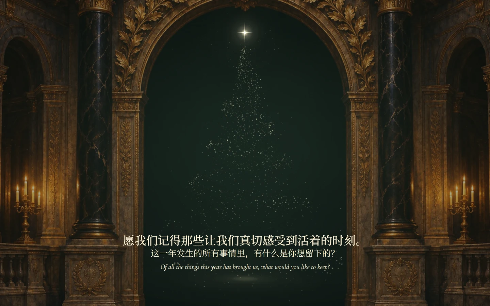
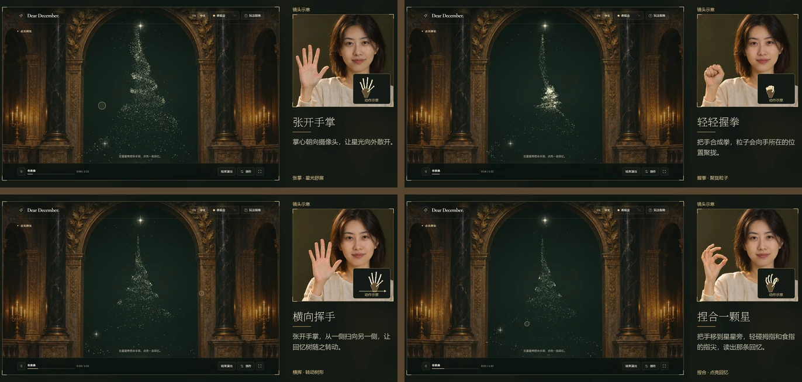
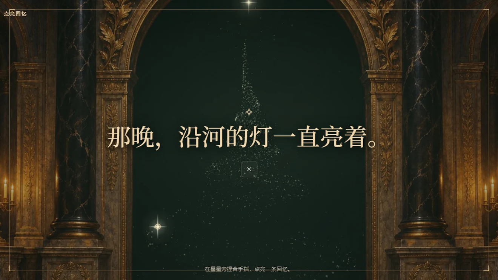

# Dear December · 亲爱的十二月

*Some things are worth keeping.*

[走进装置](https://dear-december-memories.sweet-pony-8082.chatgpt.site/) · [下载 49 秒手势演示](https://raw.githubusercontent.com/Gloria040510/dear-december/main/media/dear-december-gesture-demo.mp4) · [English](README.md)



年底想起的，可能是下雪时坐过的一班火车，也可能是朋友在路口回头等你的那几秒。**Dear December** 是一件可以亲手参与的冬日数字艺术装置。写下最多五件你舍不得忘的事，让它们成为圣诞树上的星星。音乐改变树的呼吸，手的动作改变星光的走向。等树成形，用指尖轻轻捏合，一句话就从光里浮出来。

树上最多留五颗记忆星，取舍也是作品的一部分。把一件小事写下来，再停一停，等它亮起。我们想给回忆留出这几秒钟。

## 从一封信开始

1. **写一件想留下的事。** 写下最多五条回忆，选原创环境音《冬夜曲》，或从设备选择一首歌。页面顶部的 **EN / 中文** 会切换界面和导出文案。首次访问跟随浏览器语言，手动选择保存在当前设备。
2. **让星光随你而动。** 选择 **手势控制**，点击 **开始**，允许摄像头访问，并让手掌出现在画面里。用鼠标或触屏也可以参与，拖动让星光聚拢，按住 Shift 移动鼠标可以散开星光。想先看看完整的演出，可以点 **观看演示**，留空时会使用示例回忆。
3. **点亮一颗星。** 等回忆树成形，把手移到星星旁，轻碰拇指与食指。用鼠标或触屏时，直接点星星即可。
4. **把作品留下来。** 音乐结束后，或点击 **结束演出**，可以保存 PNG 海报。想录下动态过程，在演出中打开 **创作**，选好比例和格式，再点击 **开始录制**。点击 **停止录制** 后下载带配乐的视频。

## 让手势说话



| 怎么做 | 画面会怎样 |
| --- | --- |
| 掌心朝向镜头，打开五指 | 星光向外舒展 |
| 手指收拢，轻轻握拳 | 粒子向手所在的位置聚拢 |
| 张开双手，缓慢分开或靠近 | 分开时树体变宽，靠近时树体收拢、星光变亮 |
| 手掌从一侧向另一侧挥过 | 星尘沿手势方向旋转 |
| 树成形后，在一颗星旁合拢拇指和食指 | 星星亮起，显示对应的回忆 |

演示片和上图使用真实网站录屏，示范人物与手势输入为模拟。粒子、回忆文字和海报由网站在录制时生成。



## 画面和声音如何一起变化

**光与形状。** 宫殿是插画背景，树由 Three.js、WebGL 2 与 GLSL 实时生成。GPU 最多模拟 65,536 个粒子，粒子在手部力场和螺旋树体之间缓慢过渡，绘制密度随帧率调整。浮点纹理渲染不可用时会切换至精简 CPU 模拟。可选 **香槟金、冬夜、森林** 三套配色。

**动作与音乐。** MediaPipe 每只手提取 21 个三维关键点。EMA 平滑掌心位置，双手间距控制树形，时序 CNN 通过 ONNX Runtime Web 分析 32 帧、每帧 17 个特征。几何规则可以即时响应，也会在模型置信度较低时回退。连续帧确认与捏合迟滞减少误触。Web Audio 提取 FFT、频段能量、RMS、谱质心、谱通量、起音和近似节拍，让低频推开树冠，高频影响星光色温，起音在树底带出柔和的光波。《冬夜曲》由浏览器内的程序合成。

**创作与隐私。** 支持 9:16、16:9、影院模式、可选摄像头小窗及人物抠像。按 Esc 或 C 恢复控件。海报长边为 2,560 像素，视频长边为 1,280 像素、最高 30 帧每秒。格式取决于浏览器。回忆、本地音乐、摄像头画面和导出内容在设备上处理。推理资源可能从 Google Cloud Storage 和 jsDelivr 下载。摄像头需要 HTTPS 或 localhost，实时画面需要 WebGL 2。

## 本地运行

需要 Node.js 20.19+ 或 22.12+。

```sh
npm ci
npm run dev
```

打开 Vite 输出的本地地址。用 `npm run build` 生成 `dist/`，可部署到 HTTPS 静态站点。用 `npm run preview` 在本机检查构建结果。

## 手势模型与评估

```sh
python -m pip install -r model/requirements.txt
python model/generate.py
python model/train.py
```

[数据生成器](model/generate.py)生成 6,480 条 32 帧序列，按 18 组参数化骨架模板和轨迹来源划分。第 0–11 组用于训练（4,320 条），第 12–14 组用于选择检查点（1,080 条），第 15–17 组用于测试（1,080 条）。各集合来源分组隔离，均来自同一个合成生成器。增强包含掌形、旋转、位置、速度、尺度、关键点抖动与遮挡。

| 留出的合成测试集 | 准确率 |
| --- | ---: |
| 时序 CNN | 95.37% |
| 几何规则基线 | 73.70% |

[ONNX 模型](public/model/gesture.onnx) · [分类指标与混淆矩阵](public/model/metrics.json) · [浏览器基准样本](public/model/benchmark.json)

基准测试先核对留出样本的推理结果和 PyTorch 预测。开发机 Chromium 上的 80 次预热后 WASM 测试得到 **0.40 ms 中位数**、**0.90 ms p95**。计时包含张量构建、推理和结果解析。摄像头检测、初始化、调度和采集 32 帧的耗时在测量范围之外。可以在网页的 **手势实验室** 测量当前浏览器。

**独立真实摄像头评估目前有 0 条标注样本。** 上表反映合成数据表现。可在 **手势实验室** 录制各类动作并导出 JSON，保存到 `model/captures/` 后运行 `python model/train.py --real model/captures` 查看单列的真实样本评估。后续若进行校准，请为校准和评估分别录制。

项目源代码、生成器与自训 ONNX 权重采用 [MIT 许可证](LICENSE)。第三方依赖、字体和外部模型资产遵循各自的许可。

> 这一年发生的所有事情里，有什么是你想留下的？
